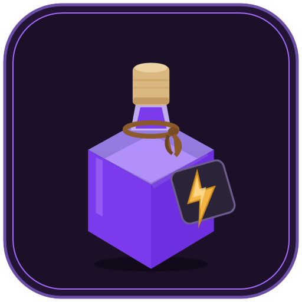

# PowerPotion ⚡

<p align="center">
  
</p>

**A personalized, clean-room real-time renderer for Autodesk Revit** — live rendering, material
editing, sun/location, sky/clouds, sections, glass, post-processing and capture — **without VR,
accounts or authentication**, packaged as a single installer with a clean uninstaller.

PowerPotion ships its **own standalone Vulkan 1.3 renderer** (`PowerPotion.Rendering`). It does not
load, link, modify or redistribute any Chaos/Enscape binary or asset, and it does not require an
Enscape installation. The original behavior was studied from public APIs and static
reverse-engineering evidence (kept under `docs/` as historical notes); all renderer code and
shaders here are our own.

## What's inside

```
power-potion/
├── assets/branding/               # logo (SVG/PNG/ICO), ribbon icons, installer art
├── docs/                          # historical REA notes + per-phase reports
│   ├── ARCHITECTURE.md            # architecture + historical Enscape mapping notes
│   ├── NOT-IMPLEMENTED.md         # deferred features, approximations and inert settings
│   ├── p4-report.md … p6-report.md
│   └── rea-report-*.md            # historical analysis (no longer used by the product)
├── src/
│   ├── PowerPotion.Protocol/      # wire protocol between the Revit add-in and the host
│   ├── PowerPotion.Rendering/     # standalone Vulkan renderer + shaders
│   ├── PowerPotion.Host/          # WPF host: child HWND, Vulkan surface, live-sync UI
│   └── PowerPotion.Revit/         # Revit 2026 add-in (ribbon, exporter, live sync)
├── installer/PowerPotion.iss      # Inno Setup script → PowerPotionSetup.exe
├── build.cmd                      # builds everything + packages the installer
└── LICENSE.txt                    # personal/educational use, trademark notes
```

## Feature mapping

| Feature | PowerPotion implementation |
|---|---|
| Real-time render window | `PowerPotion.Host` + `VulkanSurface` (child HWND, Vulkan swapchain) |
| Ribbon tab + panels | PowerPotion tab — Start/Stop/Pause, capture, material editor, sun |
| Live geometry sync | `SceneExportContext` over Revit's `IExportContext` |
| Materials | `RevitMaterialParser` + GGX PBR, 4 texture slots, glass/water/foliage |
| Photometric lights + IES | `LightParser` + renderer light buffer/IES sampling |
| Sun, location, north angle, time-of-day | NOAA solar position + procedural sky/shadows |
| Sky, clouds, fog, quality, exposure | host panels → typed renderer settings |
| Camera modes / sections | perspective/ortho/two-point, section planes, glass refraction |
| Post / capture | ACES, TAA, SSAO/SSGI, bloom/grading, PNG/JPG/EXR, panorama |
| Screenshot + panorama | renderer capture at window or explicit resolution |
| **VR / HMD** | ✗ not ported by design |
| **Accounts / login / licensing** | ✗ not present |

## Prerequisites

* **Autodesk Revit 2026** (the add-in targets the .NET 8 Revit API)
* **Windows 10/11 x64** with a **Vulkan 1.3-capable GPU**
* No separate rendering engine is required.

## Build

```cmd
:: from the repository root (adjust paths if needed)
build.cmd
```

`build.cmd` compiles the Protocol, Rendering, Host and Revit projects (Release) and packages the
Inno Setup installer if `ISCC.exe` is on the PATH. Without Inno Setup the full binaries are under
each `src/*/bin/Release`.

## Install / Uninstall

* **Install**: run `installer\Output\PowerPotionSetup.exe`. It
  * copies the renderer host and its Vulkan renderer to `%LocalAppData%\PowerPotion`
  * installs the Revit add-in manifest into `%AppData%\Autodesk\Revit\Addins\2026`
  * registers an uninstaller in Add/Remove Programs (per-user, no admin needed)
  * After installation, (re)start Revit and open any 3D view → **PowerPotion tab → Start Live Render**
* **Uninstall**: `Add/Remove Programs → PowerPotion` (or the Start-menu entry). The uninstaller
  * kills a running renderer host,
  * removes the add-in manifest, add-in DLLs, host app, `%LocalAppData%\PowerPotion` and
    `%AppData%\PowerPotion` (settings), leaving Revit untouched.

## How it works (short version)

1. The Revit add-in exports the active 3D view with Revit's `CustomExporter` (`IExportContext`)
   into a compact binary world snapshot (geometry, materials, lights, sun, camera).
2. It starts `PowerPotion.Host.exe --port <n>`. The host creates a child HWND, initializes the
   standalone Vulkan renderer, uploads the world over a localhost TCP socket and presents the
   rendered frame into the WPF layout.
3. While you model, `DocumentChanged` events trigger debounced re-exports; the active view's
   camera is streamed at ~30 Hz; sun/location and material edits push on demand.
4. Host settings panels map onto the renderer's typed settings/CVar surface (`r_skyboxFile`,
   `r_cloudDensity`, `r_fog`, `g_SunPower`, `sys_spec`, `r_renderScale`, `r_ssao`, `r_ssgi`, …).

Historical architecture notes and the empirical calibration evidence remain in
`docs/ARCHITECTURE.md`; they describe the studied product, not a runtime dependency.

For the current list of deferred features, approximations and settings that are accepted but have
no effect, see **`docs/NOT-IMPLEMENTED.md`**.

## Branding

The dark-purple theme and potion mark live in `assets/branding/`:

* `logo.svg` / `logo-badge.svg` — vector source, plus PNGs at 512/256/32/16 px.
* `powerpotion.ico` — multi-size application/installer icon.
* `icons/*.svg` and `ribbon-icons.png` — the eight Revit ribbon glyphs.
* `installer/wizard*.bmp` — Inno Setup wizard artwork.

The Revit add-in embeds 16×16 and 32×32 PNGs (Revit's icon rules) in
`PowerPotion.Revit.dll`; the host window, taskbar icon, installer and Start-menu
shortcut use the same mark. Everything is generated from one vector definition:

```cmd
dotnet run --project tools\BrandGen
```

## Legal

Personal/educational use. PowerPotion contains no Chaos/Enscape code, binaries, shaders or
textures. The renderer is our own Vulkan implementation built from public literature; the
historical reverse-engineering notes are retained as documentation only. See `LICENSE.txt` and
`docs/THIRD-PARTY-NOTICES.md`.
